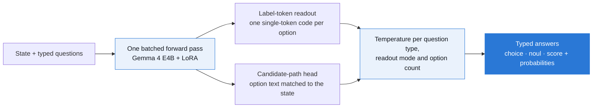

<!--
<p align="center">
  
</p>
-->

# gev

gev is an open System One decision model on **Gemma 4 E4B**, and the harness that measures it. Give it a **state** (text, a ticket, an email, or JSON) and a set of typed questions (yes/no, choice, score), and it answers all of them in one forward pass, reading each answer from logits it already computed. It returns calibrated probabilities over exactly the options you supplied and generates no tokens. The model is a LoRA adapter on `google/gemma-4-E4B-it`; the wire protocol is TypeSafe's `/v1/systemone`, so any TypeSafe client works against it by changing the base URL.

gev is a fork of [lev](https://github.com/InterfazeAI/lev), which built the same system on Qwen3.5-4B. The engine, readouts, calibration, data pipeline and benchmark harness are lev's; gev moves the backbone to Gemma 4 E4B and the training to a DGX Spark, a rented H100 or Google Colab ([ADR-031](docs/DECISIONS.md#adr-031--gemma-4-e4b-replaces-qwen35-4b-trained-in-bf16-on-a-dgx-spark-or-an-h100)).

<p align="center"><a href="https://github.com/rcythr/gev/actions/workflows/ci.yml"></a> <a href="LICENSE"></a>  </p>

<p align="center"><a href="#status"><strong>Status</strong></a> · <a href="#train-it">Train it</a> · <a href="#quickstart">Quickstart</a> · <a href="#why-it-works">Why it works</a> · <a href="#the-baseline-to-beat">Baseline</a> · <a href="#measure-it-yourself">Benchmark harness</a> · <a href="#watch-it-decide">Snake demo</a> · <a href="docs/DECISIONS.md">Decision log</a></p>

**No generated tokens, no JSON to parse, no retries.** gev cannot return a label outside your options, because the answer space is the option set you send. It can still pick the wrong option: the guarantee is structural, not a guarantee of correctness.

## Status

| Part                                     | State                                                                                                                       |
| ---------------------------------------- | --------------------------------------------------------------------------------------------------------------------------- |
| Gemma 4 E4B backbone, `gemma` prompt     | **built, tested offline** on a tiny Gemma 4 with every E-model feature; not yet run on the released weights                 |
| Training: DGX Spark, H100, Colab         | **built**; `e4b-instruct` preset, bf16 LoRA r32, no quantization; no full run yet                                           |
| Calibration, serving, release packaging  | **built**, inherited from lev; Gemma's final logit softcap now applied when serving, so served logits match trained ones    |
| Trained weights                          | **none yet**: no published checkpoint, no S1Bench score                                                                     |

Every accuracy, calibration and speed figure in this repository's docs was measured on lev's Qwen3.5-4B release. None of it has been re-measured on Gemma.

## Train it

The fastest path is Colab: open [`notebooks/train_colab.ipynb`](notebooks/train_colab.ipynb) on an **H100, A100 or L4** runtime. It clones this repository, builds the training mixture once to Google Drive, runs a 20-step smoke test on Gemma 4 E2B, trains, calibrates, tries the model and packages a release. Checkpoints live on Drive, so after a disconnect you run every cell again and training resumes where it stopped. A free T4 cannot train it: 16 GB is about E4B's bf16 weights alone, and the T4 has no native bf16.

On your own GPU:

```bash
huggingface-cli login                             # after accepting the Gemma 4 licence on the Hub
make setup-train                                  # torch, transformers, peft
make test                                         # the full suite: no GPU, no network, no API keys
make data                                         # 29 public sources -> train / calibration / test
make smoke-local STEPS=20                         # prove the path on Gemma 4 E2B first
uv run gev plan --preset e4b-instruct --data data/mixture --gpu h100
make train-local PRESET=e4b-instruct              # resumes the newest checkpoint; FRESH=1 starts over
make calibrate-local PRESET=e4b-instruct
```

```text
model            google/gemma-4-E4B-it  (4.5B, bfloat16)
adaptation       LoRA r32
prompt           gemma prompts, Mode A to the tokenizer limit
data             200,000 examples x 128 tok x 3 epochs  = 0.08B tokens
steps            18,750 (32 ex/step, ~4,096 tok/step)
compute          2.76e+18 FLOPs
time estimate    8.8 hours (0.4 days) on H100 80GB
memory           14.9 GB state, 65.1 GB headroom of 80 GB
```

| GPU (`--gpu`)                           | Estimated hours | Micro-batch x accumulation |
| --------------------------------------- | --------------: | -------------------------- |
| H100 80GB (`h100`)                      |             8.8 | 32 x 1                     |
| A100 80GB / 40GB (`a100-80`, `a100-40`) |            27.8 | 32 x 1 / 16 x 2            |
| L4 24GB (`l4`)                          |              72 | 8 x 4                      |
| DGX Spark (`spark`)                     |              87 | 32 x 1                     |

The H100 figure is scaled from lev's measured Qwen run; the others scale it by peak bf16 throughput and are unmeasured. The 128-token prompt length was measured under the Qwen tokenizer: `gev plan --data` re-measures it under Gemma's. `--per-device-batch` and `--grad-accum` fit the run to the card while the optimiser batch stays 32, and `--keep-last N` bounds disk.

Training stops before loading the model if the `gemma` prompt framing differs from the tokenizer's own chat template, and prints both. The data build refuses any source that resolves to one of the 13 S1Bench subsets. [TRAINING.md](docs/TRAINING.md) covers the pipeline step by step; [SETUP.md](docs/SETUP.md) covers Modal.

## Quickstart

```bash
pip install "gev[serve] @ git+https://github.com/rcythr/gev#subdirectory=packages/gev"
```

In-process, against a checkpoint you trained. Omit the checkpoint to serve the untrained instruct model zero-shot:

```python
import gev

model = gev.load(
    "checkpoints/gev-e4b-instruct", model_id="google/gemma-4-E4B-it", prompt_style="gemma"
)
result = model.system_one(
    "Hi, I was charged twice for my order #4471 and I want a refund.",
    {
        "intent": {
            "type": "choice",
            "instructions": "What does the customer want?",
            "criteria": {
                "refund": "wants money back",
                "cancel": None,
                "track": None,
                "other": None,
            },
        },
        "urgent": {"type": "noul", "instructions": "Does this need a human within the hour?"},
    },
)
result.answers["intent"].choice  # "refund"
result.answers["urgent"].noul  # probability the answer is yes
result.usage.output_tokens  # 0
```

Or as a server, with any TypeSafe client:

```bash
gev serve --checkpoint checkpoints/gev-e4b-instruct --model google/gemma-4-E4B-it --prompt-style gemma
```

```python
from typesafe_sdk import Choice, Noul, TypeSafeClient

client = TypeSafeClient(base_url="http://localhost:8000", api_key="local", timeout=60)
response = client.system_one(
    state={"ticket": "The app crashes every time I open settings."},
    questions={
        "team": Choice(
            instructions="Which team owns this?", criteria={"billing": None, "technical": None}
        ),
        "bug": Noul(instructions="Is this a bug report?"),
    },
)
```

Python 3.12+. A packaged release (`gev release build`) records its base model and prompt style in `gev_release.json`, so `gev serve --checkpoint <release>` needs no other flags.

## Why it works



Each option gets a short code, and the answer is read from the next-token logits over those codes. Choices are read in two option orders and averaged, which cancels position bias. Codes that would split into two tokens are skipped, so this reaches several hundred options.

**A router between two readouts.** When options stop fitting in single tokens, the question goes to a small learned head that matches the state against each option's text, so there is no fixed option ceiling. [ADR-005 →](docs/DECISIONS.md#adr-005--dual-mode-readout-the-differentiator)

**Calibration is a first-class objective.** One temperature is fitted per question type, readout mode and option-count band, and the shipped temperatures are chosen by how well they carry over to task families left out of the fit. [ADR-006 →](docs/DECISIONS.md#adr-006--calibration-is-the-product) · [ADR-028 →](docs/DECISIONS.md#adr-028--skip-split-label-codes-when-serving-calibrate-for-families-the-model-has-not-seen)

**What Gemma changed.** Gemma softcaps its final logits, and the engine projects logits itself, so it now applies the same cap; otherwise served probabilities would differ from the ones calibration fitted. Gemma 4 ships vision and audio encoders in the same checkpoint; they load frozen and are excluded from LoRA, ready for image and audio states later, while requests stay text-only for now. The prompt is framed in Gemma 4's own turn format. [ADR-031 →](docs/DECISIONS.md#adr-031--gemma-4-e4b-replaces-qwen35-4b-trained-in-bf16-on-a-dgx-spark-or-an-h100)

|                      | An LLM generating JSON         | gev                                                  |
| :------------------- | :----------------------------- | :--------------------------------------------------- |
| Output work          | Emit the object token by token | Read logits over the option codes                    |
| Out-of-set labels    | Possible; validate and retry   | Impossible by construction                           |
| Probabilities        | Not native to sampled text     | A calibrated distribution per question               |
| Options per question | Bounded by the prompt          | Several hundred by label code, unbounded by the head |

## The baseline to beat

<!--
<p align="center"></p>
-->

lev, the Qwen3.5-4B model gev is forked from, scored **0.689 macro on all 13 S1Bench subsets** against Jev's 0.761, through the same harness on the same 3,880 items. These are lev's numbers, not gev's; a Gemma run gets scored the same way with `make s1bench` and `gevbench eval`.

| subset               | task                           | lev (Qwen3.5-4B) |       Jev | always the most common label |
| -------------------- | ------------------------------ | ---------------: | --------: | ---------------------------: |
| vitaminc-dev         | claim verification             |            0.668 | **0.801** |                        0.503 |
| massive-en-US        | intent routing, 18 scenarios   |            0.857 | **0.874** |                        0.163 |
| massive-de-DE        | intent routing, German         |            0.823 | **0.871** |                        0.163 |
| boolq                | yes/no reading comprehension   |            0.827 | **0.893** |                        0.580 |
| squad2               | answerability                  |            0.813 | **0.836** |                        0.502 |
| paws                 | adversarial paraphrase         |            0.776 | **0.900** |                        0.516 |
| multinli             | natural language inference     |        **0.890** |     0.836 |                        0.361 |
| civil_comments       | toxicity                       |            0.760 | **0.803** |                        0.893 |
| aegis2               | safety moderation              |            0.800 | **0.804** |                        0.568 |
| helpsteer2           | helpfulness, 5 levels          |        **0.386** |     0.341 |                        0.422 |
| summeval-relevance   | summary relevance, 5 levels    |            0.358 |     0.358 |                        0.458 |
| summeval-consistency | summary faithfulness, 5 levels |            0.271 | **0.812** |                        0.840 |
| pubmedqa             | biomedical yes/no/maybe        |            0.732 | **0.764** |                        0.532 |
| **macro**            |                                |            0.689 | **0.761** |                              |

Mean ECE was 0.115 for lev and 0.091 for Jev. At these sample sizes a per-subset difference needs roughly 5–9 points to be real. [Every lev run, per-subset breakdowns and what each run changed →](docs/FINDINGS.md)

<!--
<p align="center"></p>
-->

### Engine optimizations inherited from lev

<!--
<p align="center"></p>
-->

Measured on lev's Qwen backbone; whether each still pays on Gemma is unmeasured.

- **One batched forward instead of prefill-and-fork: 169 → 69 ms** on an H100, because the forward at this size is bound by kernel launches, not arithmetic. [ADR-023 →](docs/DECISIONS.md#adr-023--one-batched-forward-not-prefill-and-fork)
- **Label-token readout up to the tokenizer's limit: +51 points on MASSIVE's 60 intents.** [ADR-025 →](docs/DECISIONS.md#adr-025--serving-routes-mode-a-up-to-the-tokenizer-limit-training-keeps-its-cap)
- **Skipping label codes that split into two tokens: banking77 0.818 → 0.980.** [ADR-028 →](docs/DECISIONS.md#adr-028--skip-split-label-codes-when-serving-calibrate-for-families-the-model-has-not-seen)
- **The backbone's own prompt format: 0.653 → 0.710 frozen**, which is why gev frames prompts in Gemma's turn format. [ADR-027 →](docs/DECISIONS.md#adr-027--the-prompt-is-dressed-in-the-backbones-own-format)

## Measure it yourself

`gevbench` measures gev, Jev, and any `/v1/systemone`-compatible server through the same code path: one changed flag.

```bash
gevbench eval  --backend jev                       # the hosted API
gevbench eval  --backend gev  --tasks data/eval    # localhost:8000 by default
gevbench compare                                   # vs an LLM baseline
gevbench sweep                                     # batching economics
gevbench confidence                                # which statistic is `confidence`?
```

It reports accuracy, log loss, Brier, **ECE with reliability bins**, selective accuracy, p50 latency, tokens, cost, and schema-retry counts; its test suite runs offline against a fake transport, with no key. Omit `--tasks` and you get a built-in 24-item fixture, which is a smoke test: at n=24 the 95% interval is **±16 accuracy points**. `make eval-set` writes the real held-out set and `make s1bench` the S1Bench subsets. [ADR-015 →](docs/DECISIONS.md#adr-015--the-24-item-task-set-is-a-fixture-not-a-benchmark)

`gevbench` deliberately does **not** depend on the model package. A measuring instrument that imports the thing it measures is not an instrument. [ADR-010 →](docs/DECISIONS.md#adr-010--two-packages-one-workspace)

## Watch it decide

The model plays Snake, one `/v1/systemone` call per move, against any System One server through the same client the benchmark uses.

```bash
uv sync --extra demo
uv run gevbench snake --backend planner                        # no server: the planner plays
make snake URL=http://localhost:8000                           # gev
uv run gevbench snake --backend jev --steps 200 --record artifacts/snake/jev.jsonl
uv run gevbench replay artifacts/snake/jev.jsonl              # play it back at original speed
```

The display shows the board, the four direction probabilities with the model's pick marked and unsafe moves flagged, and the model's dead-end-risk and food-reachability estimates beside the planner's ground truth. **By default a planner shield overrules an unsafe first choice** and the display marks it `SHIELD`; `--unassisted` removes the shield, so deaths end the run.

## Boundaries worth understanding

- **Finite typed answers only.** Yes/no, one of N options, or a score over 2–10 levels. No free text, nested schemas or unbounded numbers.
- **Questions are answered independently.** Answers in one request do not condition on each other. Encode a joint decision as one choice, or ask in stages.
- **Minimal edits and fine-grained ratings were lev's weak spots.** Inputs that differ by one swapped word or number, and quality ratings over five levels, were where lev was least accurate and could be confidently wrong. Expect the same until a Gemma run shows otherwise.
- **Calibration is fitted on the training distribution.** Temperatures are chosen to transfer across task families, but a task very unlike the training mix may be less well calibrated. Check on your own data before gating on the probabilities.
- **A GPU for real-time use.** E4B in bf16 needs about 16 GB of GPU memory to serve; CPU works, far more slowly.

## Layout

```text
packages/
  gev/          the model     — schema, prompt layouts, router, readouts, calibration, loader, server, S1Bench export
  gevbench/     the harness   — accuracy, ECE, cost, latency, batching economics, Snake
notebooks/      train_colab   — the whole training path on a Colab H100, A100 or L4
modal/          app.py        — train / calibrate / serve / check a release on one H100
hf/             README.md     — lev's Hub model card, and the charts it shows
scripts/        publish_hf.sh — package, load-check and publish a release
docs/           ARCHITECTURE  — the design, and every model it was derived from
                DECISIONS     — one ADR per irreversible choice, with the evidence
                FINDINGS      — what Jev actually is, and every lev run measured against it
                STATUS        — what is built and how far it has been run
                SETUP, TRAINING — local, Modal and Colab, the pipeline step by step
                charts/       — the lev-vs-Jev comparison page, built from the logs
data/           sample state + the S1Bench snapshot the analysis rests on
```

## Prior work

gev is a fork of [lev](https://github.com/InterfazeAI/lev) by Interfaze; the system design, the engine and the harness are theirs. lev in turn was assembled from measured trade-offs in other people's implementations. [ARCHITECTURE.md](docs/ARCHITECTURE.md) dissects each one; the parts taken:

| From                                                                                                                                                                  | What                                                                                                                  |
| --------------------------------------------------------------------------------------------------------------------------------------------------------------------- | --------------------------------------------------------------------------------------------------------------------- |
| [lev](https://github.com/InterfazeAI/lev)                                                                                                                             | everything gev did not change: engine, readouts, router, calibration, data pipeline, benchmark harness                |
| [reflex](https://github.com/kshetrajna12/reflex)                                                                                                                      | post-hoc temperature calibration, the cheapest large win                                                              |
| [decider](https://github.com/Mapika/decider)                                                                                                                          | dual prompt layouts (trained; the cross-request schema cache they allow is designed, not built), abstain augmentation |
| [simple-jev](https://github.com/featherless-ai/simple-jev)                                                                                                            | nine-rating-token Noul                                                                                                |
| [NanoJev](https://github.com/TianyuCodings/NanoJev)                                                                                                                   | set attention over candidate paths, proper-scoring objectives                                                         |
| [litjev](https://github.com/zhengxuyu/litjev)                                                                                                                         | the reference prefill + logit-readout write-up                                                                        |
| [jeff](https://github.com/logan-markewich/jeff), [Nimble](https://github.com/bespokelabsai/nimble), [typed-decisions](https://github.com/kotoba-lang/typed-decisions) | encoder and LoRA baselines, and the latency numbers that ruled out diffusion; Nimble also pins the S1Bench items      |
| [JEVfire](https://github.com/kikoncuo/jevfire)                                                                                                                        | the shape of this README                                                                                              |

Benchmark data is a snapshot of a third-party S1Bench dashboard (`data/s1bench-snapshot.json`), not produced by this project; its caveats are in [FINDINGS.md §9](docs/FINDINGS.md). The 13 subset definitions (item ids, label counts, instructions and criteria) come from Nimble's public-benchmark manifests at commit `62076b4`, vendored in `packages/gev/src/gev/data/s1bench_subsets/`.

Not affiliated with or endorsed by TypeSafe AI, Interfaze or Google.

## License

The code is [Apache-2.0](LICENSE). Weights you train are a derivative of Gemma 4 and carry its licence terms; some training datasets have their own terms, including non-commercial ones.
